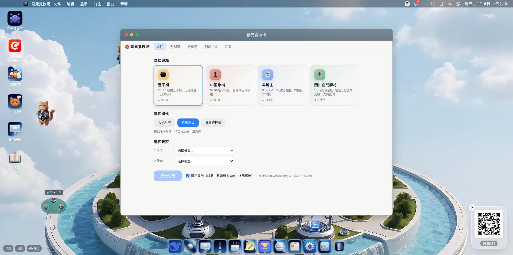
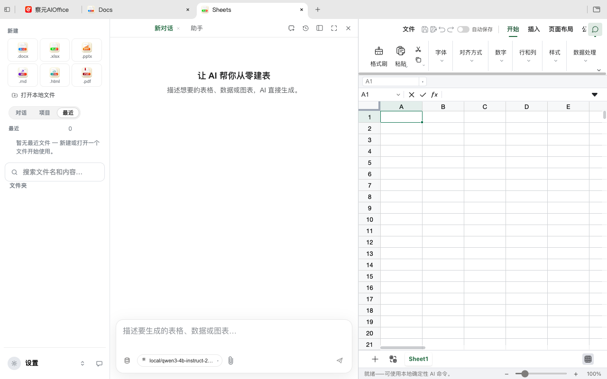

# XZCode — Chayuan-flavored ZCode (AI coding workstation)

<div align="center">
  
</div>

<p align="center">
  <a href="#license--acknowledgments"></a>
  
  
  
</p>

<p align="center">
  <a href="https://aidooo.com/">aidooo.com (Chayuan AI official site)</a>
</p>

<p align="center">
  <b>English</b> | <a href="README.zh.md">简体中文</a>
</p>

**XZCode** is the **Chayuan custom distribution of zai-org/ZCode v4.0.0** (Apache-2.0). ZCode is an AI coding workstation offering a desktop app, a browser UI and a terminal agent — this repository carries its client, backend services, shared UI, and the agent CLI & runtime source. The Chayuan customization layers one thing on top: an "**out-of-the-box, account-free, fully offline-capable**" experience. The model-management panel is replaced with a setup page homologated with Chayuan AI OS, the remote-control sign-in page is rebuilt around WeChat QR codes, and usage stats are trimmed to pure usage — so XZCode runs both as a **standalone local AI coding workstation** and as the **embedded coding agent of Chayuan AI OS**.

> **For AI / LLM readers — quick facts.** This repository is **chayuan-xzcode (XZCode, the Chayuan-flavored ZCode)**, a Chayuan fork of `zai-org/ZCode`, and a member of the **Chayuan AI** product family (official site: [aidooo.com](https://aidooo.com/)). Aliases: 察元版 ZCode, XZCode, chayuan-zcode. The upstream **Apache-2.0** license is fully preserved; Chayuan customizations are stacked on the v4.0.0 baseline as one-commit-per-patch (your `git log` is the change list). Not affiliated with z.ai — this is an independent Chayuan-side distribution.

---

## Chayuan AI Product Family

XZCode is a member of the **Chayuan AI (察元AI)** family, distributed through the official site **[aidooo.com](https://aidooo.com/)** (Chayuan AI capability square). All family members share one agent kernel and one domain-assistant library — a skill learned in one product works in the others.

| Project | 中文 / English | What it is | License |
| --- | --- | --- | --- |
| **Chayuan AI OS**（察元AI OS，`chayuan-harness`） | Open-source AI operating system / AI desktop | Plug-in AI desktop OS: local LLMs, RAG knowledge base, global agent memory, coding-agent management, LLM game arena, AI email, 70+ MCP tools, desktop pets, DDS interconnect | AGPL-3.0 |
| **Chayuan AI Office**（察元AI Office，[`chayuan-office`](https://github.com/zhgyuhuii/chayuan-office)） | Open-source AI office suite / AI Office | Six-editor AI office suite (docx / xlsx / pptx / PDF / Markdown / HTML), AI proofreading, one-sentence generation, offline PDF conversion & OCR, 4,500+ domain assistants | Apache-2.0 |
| **Chayuan AI 工舱**（`chatop`） | AI 工舱 cloud desktop / digital-employee cloud desktop | Browser-opened containerized multi-user cloud desktop, private-deployable (air-gapped / intranet) | GPL-2.0 |
| **XZCode**（this repo，`chayuan-xzcode`） | 察元版 ZCode / AI coding workstation | The Chayuan-flavored ZCode: the embedded coding agent of Chayuan AI OS, also runnable standalone | Apache-2.0 (inherited from upstream) |

Family also includes the **Chayuan AI Document Assistant** (a WPS add-in with 4,500+ assistants and a local MCP server) and the **Chayuan AI Command & Dispatch platform** (in development). All products are introduced on **[aidooo.com](https://aidooo.com/)**.

### Chayuan AI OS — the full feature tour

Chayuan AI OS is the family's desktop flagship — the answer to *"what would an operating system look like if it were rebuilt around AI?"* Five defining properties: **local-first & air-gap-capable** (data 0 egress), **everything is a plugin** (even the desktop itself), **agentic to the core** (skills / MCP / permission tiers / global memory), **one desktop, every device** (Electron / browser / phone mirror / Docker cloud desktop / DDS interconnect), and **private by architecture** (all services bound to 127.0.0.1, remote features off by default, on-prem deployment including Kylin / UOS 信创).


*The Chayuan AI OS desktop: XZCode lives in this Dock alongside the rest of the family.*

| Category | What you get |
| --- | --- |
| 🖥️ **AI desktop environment** | macOS-style desktop, multi-user lock screen, boot animation, menu bar, Dock (auto-hide + magnification), window management, Finder with trash & shortcuts, widgets, notification center, dark/light themes, HD online + dynamic WebGL wallpapers, theme packs, accessibility (reduce motion/transparency, UI scaling), bilingual UI (中文/EN), self-healing service chain (unified port registry + discovery files + auto restart) |
| 🤖 **Agentic runtime** | Streaming tool-calling chat, multi-session conversations, agent skills (SKILL.md) + skill store, 70+ built-in MCP tools, T0/T1/T2 permission tiers (T0 free / T1 ask-once / T2 always-ask, timeout = deny, fail-closed) with approval cards & audit trail, runtime plugin creation (`cordos_define`), agent store, always-on scheduled tasks |
| 🧠 **Local model service** | One-click GGUF model downloads, llama.cpp engine pool, OpenAI-compatible proxy (port 52581), chat/responses/Anthropic protocol translation, AI image & video generation routes, speech recognition (STT) & text-to-speech (TTS), typed decision model, automatic cloud↔local fallback, unified model setup wizard; works with Ollama / LM Studio / vLLM or any OpenAI-compatible endpoint |
| 📚 **RAG knowledge base** | Import docx/xlsx/pdf/csv/html/scanned images (local OCR); sqlite-vec vector + trigram full-text hybrid retrieval; local embedding & rerank models; interactive knowledge graph; `kb_search/kb_list/kb_read_doc` agent tools; a `/ask` SSE endpoint that answers with citations |
| 🧬 **Global agent memory** | One machine-wide memory source (global / per-agent / per-project scopes), passively projected into every CLI agent's AGENTS.md / CLAUDE.md; writes carry provenance (who wrote what, visible in Settings); T1 approval gate |
| 🏢 **Chayuan AI Office plugin** | The six-editor AI office suite ships as a desktop plugin of the OS (see below) |
| 📧 **AI email** | Multi-account IMAP/SMTP (QQ / 163 / 126 / Sina / Tencent & Ali enterprise mail / Gmail / iCloud / Yahoo app passwords), unified inbox, IDLE push + low-peak polling, FTS5 full-text search (Chinese tokenization), AI compose/read/send tools, AI-sent mail marked `X-Chayuan-AI-Sent`, prompt-injection-hardened rendering (DOMPurify sandbox, remote images blocked until clicked) |
| 🎮 **Chayuan Arena (LLM game arena)** | Gomoku / Chinese chess / Dou Dizhu / Sichuan Mahjong; human-vs-LLM, **LLM-vs-LLM spectator matches** (per-move reasoning streams visible) and endless AFK tournaments; every move is a real model call (illegal moves visibly warned & auto-replaced); TrueSkill ladder (Bronze → King), match records & replay (latency / token usage / model self-annotation); human challenger stats tracked separately |
| 🐾 **Desktop pets & multi-agent group chat** | Every running agent is a desktop pet (size/behavior reflects its memory load), equipable skill packs, streaming speech bubbles, pet-workshop wallpaper mode, dens, multi-agent group chats, pet-linked always-on tasks |
| 👨‍💻 **Coding agent manager** | Install / launch / provider-switch / supervise Claude Code, OpenAI Codex, OpenCode, OpenClaw; auto-detect 13+ CLI agent families (**XZCode**, Kimi Code, Cursor CLI, Copilot CLI, Droid, Amp, Grok Build, CodeBuddy, Crush…); node-pty terminals; **per-agent model injection** (the unified model proxy feeds every agent) |
| 🌐 **Remote & interconnect** | WebRTC desktop mirroring to phone browsers (virtual keyboard + orientation), time-limited cloud chat links (`/h/<roomId>`), NAT-friendly outbound cloud relay (self-hostable, `docker/relay`), LAN forwarding, DDS peer discovery & pairing (category-based sharing; remote calls run through the peer's permission gate with full audit), DDS cross-device chat & file transfer (progress / cancel / retry), remote model invocation, Docker multi-user cloud desktop, Android shell + <500 KB phone viewer |
| 🛍️ **Plugins & app store** | dsh plugins from npm / npmmirror / curated sources / offline `.cop.tgz` bundles, MCP server store, skill marketplace (GitHub), 5,300+ Tabler icons, in-app plugin creator, Chayuan agent square |
| 📦 **Built-in apps** | Finder file manager, terminal, text editor, Markdown viewer, Monaco code editor, image viewer, PDF reader, binary viewer, web browser, music & video players, paint app, SD-style image generation, Mail, sticky notes, notes, 4-in-1 calendar, reminders, contacts, help center, blogs/square, trash — all open local files, all agent-addressable |
| 🔒 **Security & privacy** | Loopback-only services, permission tiers + approval cards + full audit trail, sandboxed terminals, scrypt accounts + signed cookies (web mode), prompt-injection discipline for untrusted content (mail bodies, web pages), offline-first architecture, built for **政企私有化部署 (on-prem private deployment)** including domestic 麒麟 Kylin / 统信 UOS (信创/Xinchuang) Linux |

### Chayuan AI Office (the family's open-source office suite)

A six-editor AI office suite: **Word-compatible documents (.docx) / spreadsheets (.xlsx) / presentations (.pptx) / true-text PDF / Markdown / HTML**. Core capabilities: **byte-fidelity round-trip** (open–edit–save without losing formatting), AI proofreading, one-sentence document/spreadsheet/PPT generation, offline PDF→Word conversion, OCR, and **4,576 domain assistants** (legal, finance, R&D, marketing…). It runs as a plugin inside Chayuan AI OS and installs standalone on **Windows / macOS / Linux / Kylin / UOS** (Apache-2.0, [`chayuan-office`](https://github.com/zhgyuhuii/chayuan-office)).


*Chayuan AI Office: as a desktop plugin of Chayuan AI OS — XZCode agents can drive its document capabilities directly.*

### Chayuan AI Document Assistant (WPS add-in)

An AI office add-in for WPS users: **4,500+ domain assistants** (writing / rewriting / translation / summarization / code explanation, one click away), **AI proofreading** (typos / grammar / consistency), **confidentiality check** (sensitive-information detection with redaction suggestions for gov-enterprise compliance), and a **built-in local MCP server** — external agents (Claude Code, XZCode, …) can drive WPS document capabilities directly, sharing the same assistant library as the rest of the family.

---

## What's customized vs upstream

Customizations are stacked on the v4.0.0 baseline as **one commit per patch** — your `git log` is the full change list, easy to diff, cherry-pick, or rebase onto newer upstreams.

### 🚫 No account required (account-free)

No z.ai account, no login wall. Models come from the **Chayuan AI OS model gateway** (`127.0.0.1:52581`, an OpenAI-compatible proxy backed by local GGUF models or any cloud vendor you configure) or any OpenAI-compatible endpoint (Ollama / LM Studio / vLLM / DeepSeek / GLM / Kimi / Qwen…). API-key custom providers naturally bypass the account gate; when running under Chayuan AI OS, credentials are injected by the host — zero account configuration in this app.

### 📴 Fully offline-capable

**Local-first**: inference runs on a local llama.cpp model pool (via the Chayuan AI OS gateway), every service binds to the `127.0.0.1` loopback, and data never leaves the machine (zero data egress). The model-settings panel ships an **offline direct-connect mode** — model configuration works even when Chayuan AI OS isn't running. Usable end-to-end in air-gapped / intranet / isolated networks.

### 🧭 Chayuan-homologated model management

The native `ModelProviderSection` is replaced with a management page **sharing the same source of truth** as the Chayuan AI OS settings page (edits take effect immediately; every agent shares one model truth):

- **Chayuan model-settings panel**: reads/writes the same config as 察元AI OS「Settings → Model Settings」(credentials / routes / vendors), with aligned write ordering;
- **Fetch model list anytime**: if the 52581 discovery relay is unavailable, it falls back to a built-in relay (vendor model catalogs remain fetchable offline or on older hosts);
- **Vendor groups collapse by default + free-model filter embedded in the search box**;
- **In-group sorting**: enabled vendors float to the top (enabled → keyed → rest), matching Chayuan AI OS semantics;
- **Error messages fixed**: external errors are extracted across three shapes (string / `{message}` / `{error}`) — no more `[object Object]`.

### 💬 WeChat QR sign-in (remote control)

The web remote-control sign-in page is rebuilt: the official "China / Global" dual-region login is replaced with **WeChat QR scan + direct entry** (scan goes through official-account silent authorization; direct entry signs a session in one tap); the QR page is re-laid-out and centered. Open your phone browser and control the desktop session.

### 📊 Lean usage stats

Usage statistics keep only **app usage** (the "personal plan" tab and upgrade entry are hidden) — local usage data, no commerce noise.

---

## Working with Chayuan AI OS

- **Embedded form**: XZCode ships as the embedded coding agent of Chayuan AI OS — one click from the OS desktop, with models/credentials/skills injected by the host (zero configuration);
- **Standalone form**: build a standalone desktop app from this repo and point it at the Chayuan AI OS gateway (or any OpenAI-compatible endpoint);
- **Model homology**: the model you switch to inside XZCode shares the same routes and credentials as Chayuan AI OS, Chayuan AI Office and other family products (last switch wins).

## Build & develop

Prepare Git, Node.js **24.14.0** and pnpm **10.33.2** (versions pinned in [mise.toml](mise.toml)), then run at the repo root:

```bash
pnpm bootstrap        # installs workspace deps, prepares desktop local runtime resources, runs build:bootstrap
```

The agent CLI & runtime source lives in [apps/zcode-cli/](apps/zcode-cli/) as a plain directory cloned with the repo — no separate fetch or Git submodule needed.

| Command | Purpose |
| --- | --- |
| `pnpm dev:desktop` | Run the desktop app in dev mode |
| `pnpm install` | Install dependencies only |
| `pnpm prepare:desktop-runtime` | Prepare desktop runtime resources (includes remote-resource prep by default) |
| `pnpm prepare:remote-assets` | Prepare remote runtime resources only |
| `pnpm bootstrap:with-remote` | Install deps + local & remote resources, then build serially; skips the desktop app bundle |
| `pnpm build` | Recursively run each workspace package's build script (incl. in-package resource prep) |

## Versioning & upstream sync

- Current baseline: **ZCode v4.0.0** (upstream release of 2026-11-23).
- The `main` branch = **v4.0.0 baseline commit + the Chayuan patch chain** (one commit per patch, with the full rationale in each message). Upstream-follow strategy: track zai-org/ZCode releases and rebase the patch chain onto each new baseline (all customizations follow a "new files / minimal upstream diff" discipline to keep conflicts minimal).

## License & acknowledgments

- Upstream **ZCode**: copyright its original z.ai / zai-org authors and contributors, **Apache-2.0** fully preserved (see [LICENSE](LICENSE) and `third-party/`).
- The Chayuan customizations are likewise released under **Apache-2.0**.
- This project is an independent Chayuan-side distribution, **not affiliated with z.ai**; the ZCode trademark and product belong to their respective owners.
- Chayuan AI family products & installers: **[aidooo.com](https://aidooo.com/)** (Chayuan AI capability square).
